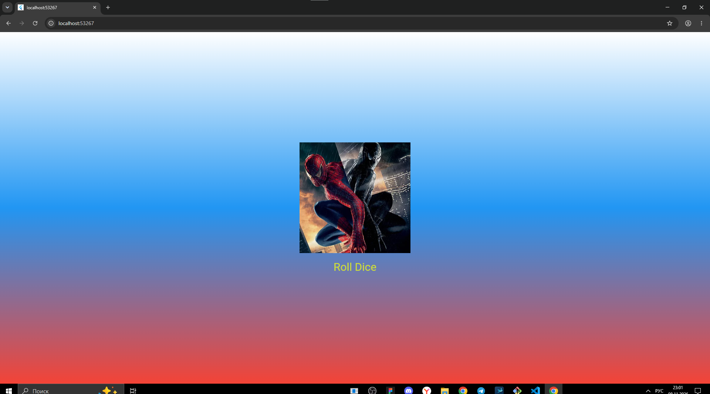

# Лабораторная работа №4-5. Flutter: структура UI и компонентный подход

**ФИО:** Орлов Иван Леонидович
**Группа:** ИСП-241
**Дата сдачи:** 08.11

## Что изучили

- Изучили что такое MaterialApp, Scaffold, Container, Center
- Создание своих виджетов и вынос их в отдельные файлы
- Передача данных в виджет через параметры
- Работа с assets
- StatefulWidget, setState и генерация случайных чисел

## Скриншот приложения



## Ссылка на репозиторий

https://github.com/VanyaOrlov2009/Flutter_Widgets

## Инструкция по запуску

1. Скачать проект:
   ```
   git clone https://github.com/VanyaOrlov2009/Flutter_Widgets.git
   cd Flutter_Widgets
   ```
2. Установить зависимости:
   ```
   flutter pub get
   ```
3. Запустить в Chrome:
   ```
   flutter run -d chrome
   ```

## Ответы на вопросы

**1. Зачем выносить виджеты в отдельные файлы? Что изменится, если держать всё в main.dart?**
Если всё в main.dart, файл станет огромным и в нём будет сложно разобраться

**2. Что такое BuildContext? Почему метод build() принимает его как параметр?**
BuildContext хранит информацию о том, где виджет находится в дереве

**3. Чем StatelessWidget отличается от StatefulWidget? Приведите пример, когда нужен каждый из них.**
StatelessWidget не хранит состояние и не меняется, например текст или фон, StatefulWidget хранит состояние и перерисовывается через setState, например кубик который меняется по кнопке

**4. Почему Random() создаётся на уровне файла, а не внутри rollDice()?**
Чтобы не создавать новый генератор при каждом нажатии